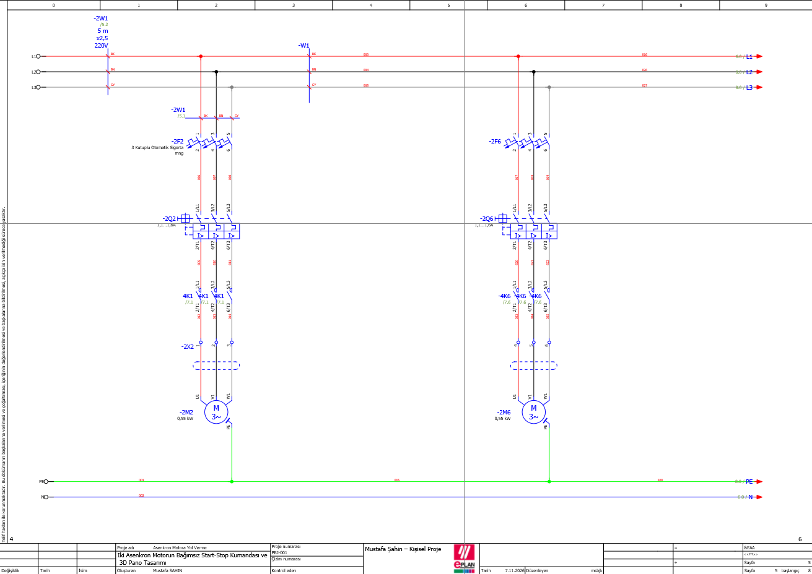
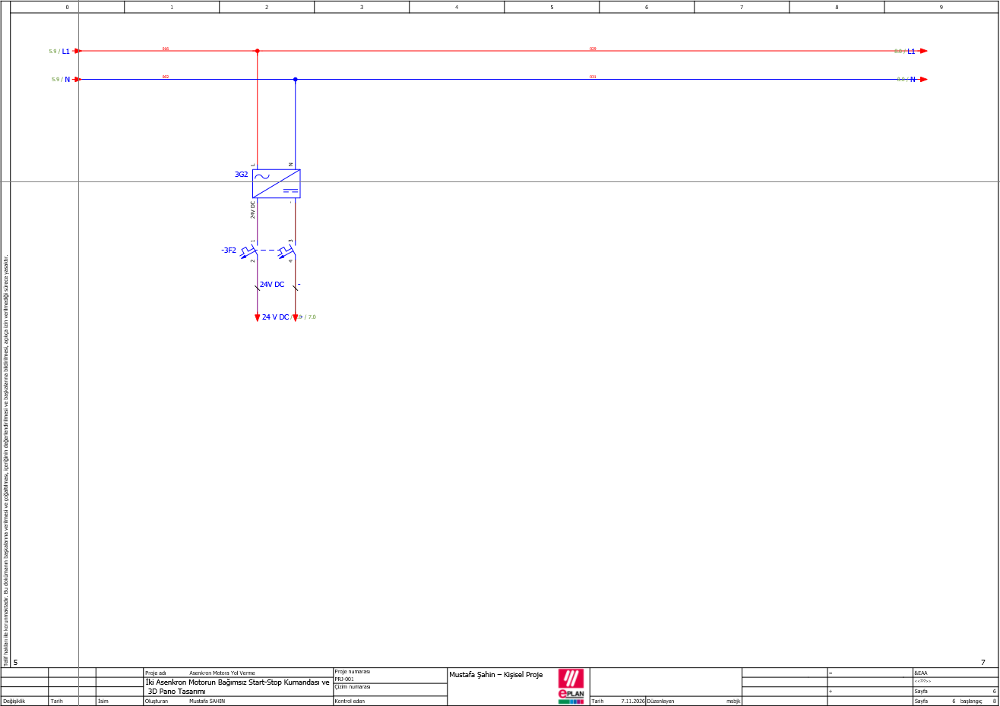
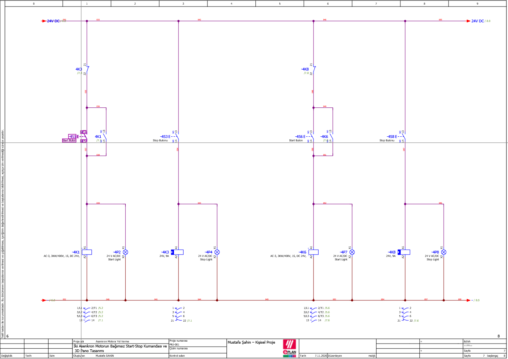
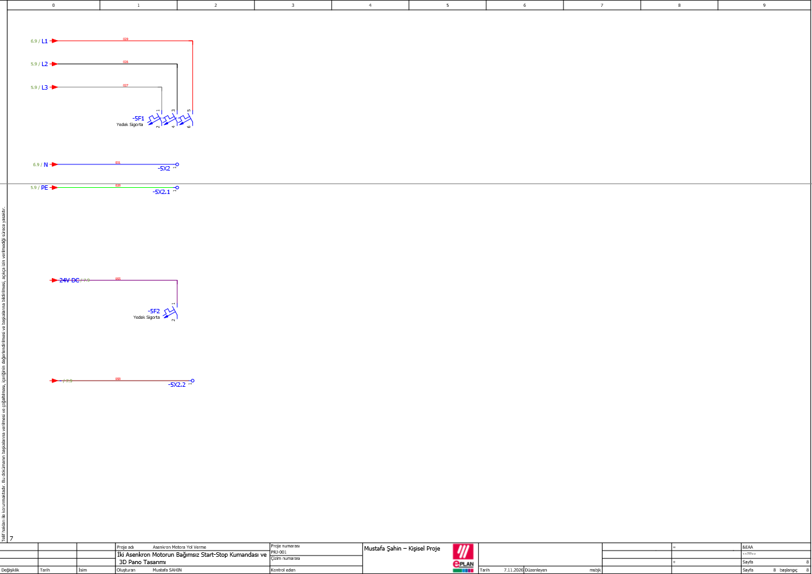
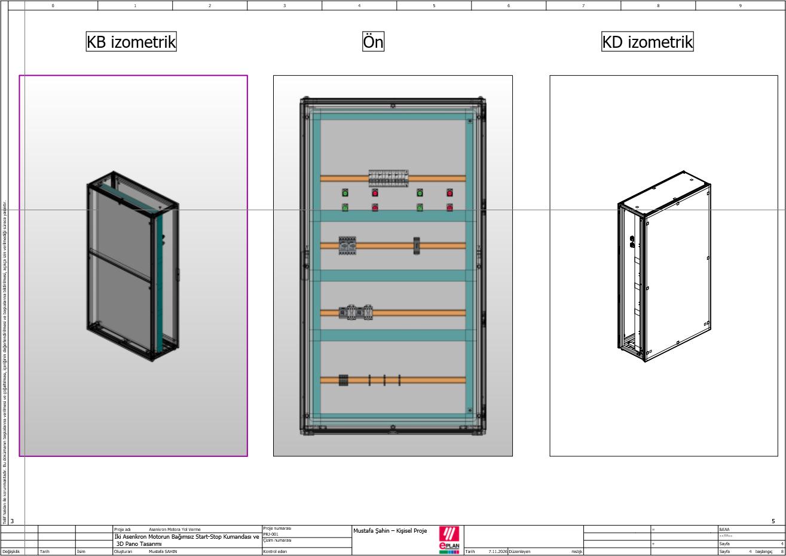
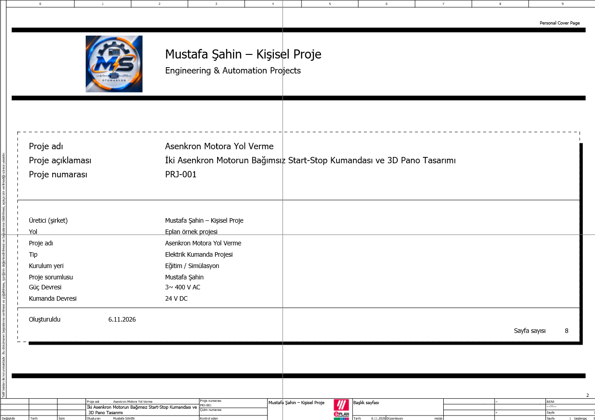
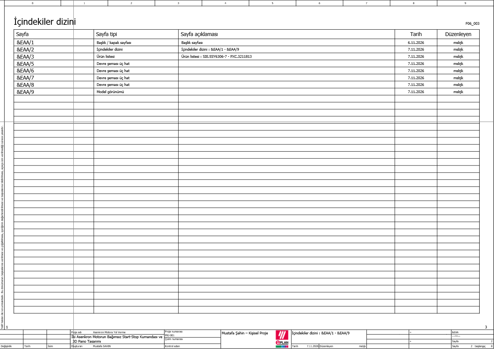

# İki Asenkron Motorun Bağımsız Start-Stop Kumandası ve 3D Pano Tasarımı

**EPLAN Electric P8 | Klasik Kumanda | Elektrik Projelendirme | 3D Pano Tasarımı**

Bu proje, iki adet üç fazlı asenkron motorun birbirinden bağımsız olarak çalıştırılması ve durdurulması amacıyla EPLAN Electric P8 kullanılarak hazırlanmış bir elektrik kumanda ve pano tasarımı çalışmasıdır.

Proje kapsamında güç devreleri, 24 V DC kumanda sistemi, motor koruma elemanları, sinyal lambaları, elektriksel bağlantılar ve 3D pano yerleşimi tasarlanmıştır.

## 1. Proje Bilgileri

| Özellik | Açıklama |
|---|---|
| Proje adı | İki Asenkron Motorun Bağımsız Start-Stop Kumandası |
| Proje numarası | PRJ-001 |
| Tasarım yazılımı | EPLAN Electric P8 |
| Proje türü | Elektrik kumanda ve pano tasarımı |
| Motor sayısı | 2 |
| Motor gücü | 2 × 0,55 kW |
| Güç devresi | 3~ 400 V AC |
| Kumanda gerilimi | 24 V DC |
| Kumanda yöntemi | Klasik röle ve kontaktör kumandası |
| Motor koruması | Motor koruma şalterleri |
| Proje kapsamı | Eğitim ve portföy çalışması |

## 2. Projenin Amacı

Bu çalışmanın amacı, endüstriyel elektrik otomasyon sistemlerinde kullanılan temel kumanda ve koruma elemanlarını uygulamalı olarak projelendirmektir.

Proje ile aşağıdaki konular üzerinde çalışılmıştır:

- Üç fazlı asenkron motorların güç devrelerinin tasarlanması
- Kontaktörlerle motor kontrolü
- Start-Stop butonlarıyla kumanda
- Yardımcı kontaklarla mühürleme devresi
- 24 V DC kumanda geriliminin oluşturulması
- Motor koruma şalterlerinin kullanılması
- Çalışma ve durdurma sinyal lambalarının tasarlanması
- EPLAN'da cihaz etiketleme ve bağlantı referansları
- 3D pano montaj yerleşimi
- Proje dokümantasyonu ve raporlama

## 3. Sistemin Çalışma Prensibi

Sistem iki ayrı asenkron motorun bağımsız kontrolüne dayanır.

### Motor 1

1. Yeşil Start butonuna basıldığında K1 kontaktörü enerjilenir.
2. Kontaktörün ana kontakları kapanır ve motor çalışır.
3. K1 yardımcı NO kontağı üzerinden mühürleme sağlanır.
4. Yeşil çalışma sinyal lambası enerjilenir.
5. Kırmızı Stop butonuna basıldığında K3 durdurma kontaktörü enerjilenir.
6. K3'ün NC yardımcı kontağı açılarak K1 kontaktörünün enerjisi kesilir.
7. Motor durur ve kırmızı durdurma komutu lambası enerjilenir.

### Motor 2

İkinci motor aynı çalışma prensibine sahiptir.

- K6: Motor 2 güç kontaktörü
- K8: Motor 2 durdurma kontaktörü
- Yeşil Start butonu: Motoru çalıştırma
- Kırmızı Stop butonu: Durdurma komutu
- Yeşil sinyal lambası: Çalıştırma durumu
- Kırmızı sinyal lambası: Durdurma komutu durumu

**Önemli:** Bu projede Start ve Stop butonlarının tamamı normalde açık (NO) kontaklıdır. Stop butonları, durdurma kontaktörlerini enerjilendirerek onların NC kontakları üzerinden motor kontaktörlerini devreden çıkarır.

## 4. Kullanılan Elektrik Ekipmanları

| Ekipman | Görevi |
|---|---|
| Üç fazlı asenkron motor | Elektrik enerjisini mekanik harekete dönüştürmek |
| Üç kutuplu otomatik sigorta | Kısa devre ve aşırı akıma karşı hat koruması |
| Motor koruma şalteri | Motorun aşırı yük ve kısa devre koruması |
| Güç kontaktörü | Motorun güç devresini açıp kapatmak |
| Durdurma kontaktörü | Kumanda devresindeki durdurma işlemini gerçekleştirmek |
| 24 V DC güç kaynağı | Kumanda devresinin beslenmesi |
| Yeşil NO buton | Motoru çalıştırma komutu |
| Kırmızı NO buton | Motoru durdurma komutu |
| Yeşil sinyal lambası | Çalıştırma durumunu göstermek |
| Kırmızı sinyal lambası | Durdurma komutu durumunu göstermek |
| Klemensler | Pano içi ve saha bağlantıları |
| DIN rayı | Elektrik ekipmanlarının montajı |

## 5. Elektrik Devreleri

### 5.1. Güç Devresi

İki adet 0,55 kW üç fazlı asenkron motor için ayrı koruma ve kontaktör devreleri tasarlanmıştır.

### 5.2. 24 V DC Güç Kaynağı

230 V AC besleme, güç kaynağı aracılığıyla 24 V DC kumanda gerilimine dönüştürülmüştür.

### 5.3. Start-Stop Kumanda Devresi

İki motorun bağımsız kontrolünü sağlayan buton, yardımcı kontak, kontaktör bobini ve sinyal lambası bağlantıları gösterilmiştir.

### 5.4. Yedek Besleme ve Klemens Bağlantıları

Gelecekteki genişletmeler için ayrılmış AC ve DC besleme çıkışları gösterilmiştir.

## 6. 3D Elektrik Pano Tasarımı

Projenin 3D pano yerleşimi EPLAN ortamında hazırlanmıştır.

Pano tasarımında aşağıdaki bileşenlerin yerleşimi üzerinde çalışılmıştır:

- Pano gövdesi ve montaj plakası
- DIN rayları
- Elektrik koruma ve kumanda ekipmanları
- Start-Stop butonları
- Sinyal lambaları
- Klemens grupları

### Pano Model Görünümleri

## 7. Proje Dokümantasyonu

Projenin kapak sayfası ve içindekiler dizini EPLAN kullanılarak hazırlanmıştır.

### Kapak Sayfası

### İçindekiler Dizini

## 8. Kullanılan Yazılım ve Teknikler

**Yazılım**
- EPLAN Electric P8
- EPLAN 3D pano yerleşim araçları

**Teknik çalışmalar**
- Elektrik güç devresi çizimi
- Klasik kumanda devresi tasarımı
- Kontaktör mühürleme devreleri
- Cihaz ve bağlantı noktası numaralandırma
- Potansiyel ve kesinti noktası referansları
- Elektrik pano yerleşimi
- Teknik dokümantasyon

## 9. EPLAN Proje Dosyası

Depoda EPLAN proje yedeği `.zw1` formatında paylaşılmıştır.

Bu dosya, uygun EPLAN sürümü ve lisansı kullanılarak geri yüklenebilir ve incelenebilir.

**Not:** Proje EPLAN Education ortamında hazırlanmış bir eğitim ve portföy çalışmasıdır. Gerçek bir endüstriyel tesiste uygulanmadan önce elektriksel koruma, ürün uygunluğu, güvenlik, kablolama ve ilgili standartlar açısından ayrıca doğrulanmalıdır.

## 10. Proje Sahibi

**Mustafa Şahin**

Elektrik Kumanda • Endüstriyel Otomasyon • EPLAN • PLC

Bu proje, elektrik projelendirme ve endüstriyel otomasyon alanındaki teknik bilgi ve uygulama becerilerini geliştirmek amacıyla hazırlanmıştır.
